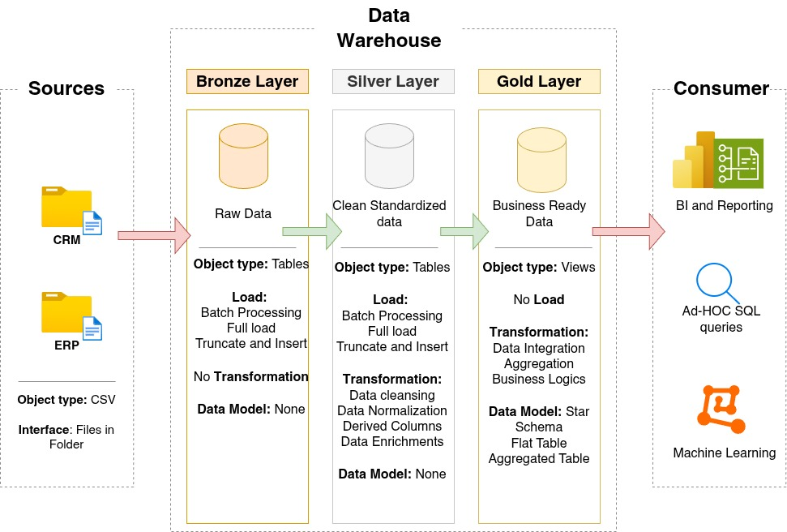
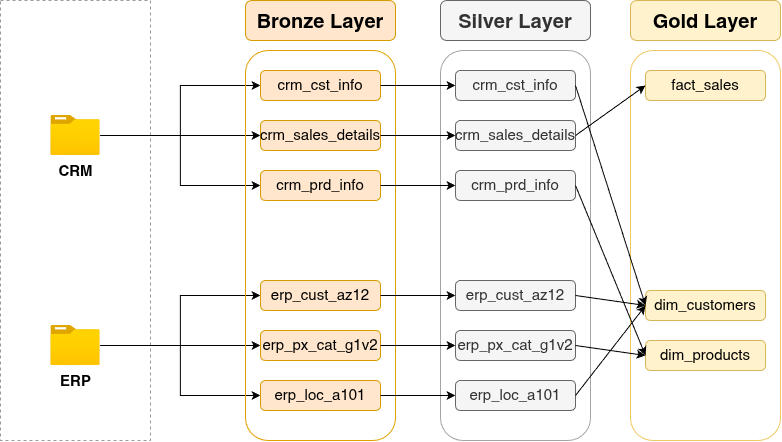
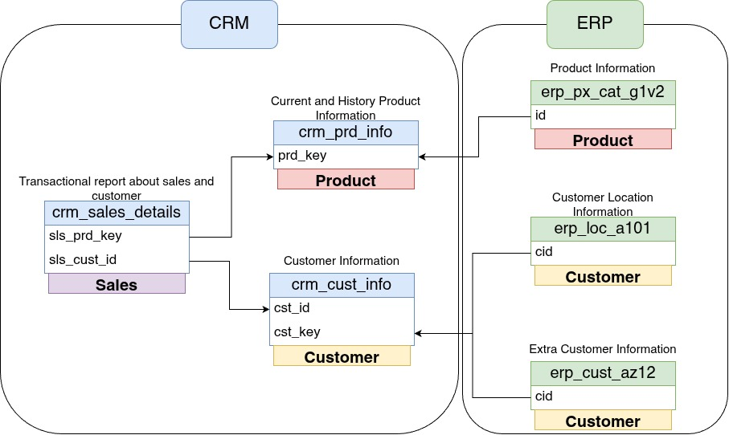
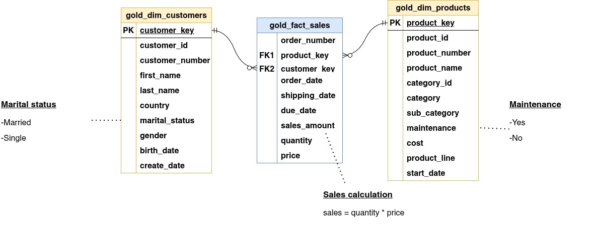
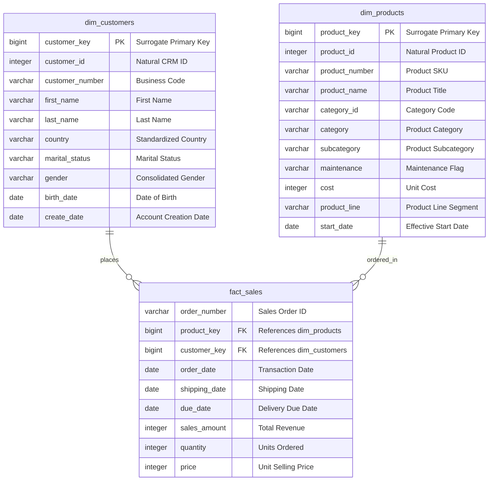

# 🏗️ Modern SQL Data Warehouse: Sales & Customer Analytics

An end-to-end modern Data Warehouse built with **PostgreSQL**, implementing **Medallion Architecture (Bronze → Silver → Gold)** and **Kimball Dimensional Modeling (Star Schema)** to unify disparate operational data from CRM and ERP systems into an analytics-ready single source of truth.

---

## 📌 Table of Contents
- [Project Overview](#-project-overview)
- [System Architecture](#-system-architecture)
- [Pipeline Layers](#-pipeline-layers)
  - [Bronze Layer (Raw Staging)](#1-bronze-layer-raw-staging)
  - [Silver Layer (Cleansing & Transformation)](#2-silver-layer-cleansing--transformation)
  - [Gold Layer (Kimball Star Schema)](#3-gold-layer-kimball-star-schema)
- [Data Modeling & Star Schema](#-data-modeling--star-schema)
- [Data Quality & Testing Framework](#-data-quality--testing-framework)
- [Project Structure](#-project-structure)
- [Setup & Execution Guide](#-setup--execution-guide)
- [Documentation & Technical Catalog](#-documentation--technical-catalog)

---

## 🎯 Project Overview

In many enterprises, business-critical data is fragmented across operational silos:
* **CRM Systems** track customer account profiles, active product catalogs, and transactional sales orders.
* **ERP Systems** maintain customer demographics, geographic locations, and product taxonomy hierarchies.

This project designs and builds an enterprise-grade SQL Data Warehouse that ingests, cleanses, reconciles, and models this disparate data to answer key business questions:
1. **Sales Performance:** Total sales revenue, transaction volumes, and product profitability over time and region.
2. **Customer Segmentation:** Purchasing patterns across demographic segments (age cohorts, gender, marital status).
3. **Product Hierarchy Analytics:** Revenue and margin breakdowns across categories and subcategories.

---

## 🏛️ System Architecture

The warehouse follows the industry-standard **Medallion Architecture**, progressing raw data through progressive stages of refinement:



### End-to-End Data Flow
The automated pipeline orchestrates data from source CSV extracts through staging, transformation, and presentation views:



---

## 🔄 Pipeline Layers

### 1. Bronze Layer (Raw Staging)
- **Role:** High-tolerance ingestion tier. Ingests raw source extracts as-is to preserve operational state and provide auditability.
- **Design Philosophy:** Relaxed typing (`VARCHAR`, `INT`) prevents pipeline crashes on malformed source records. No business constraints (`PRIMARY KEY`, `FOREIGN KEY`) are enforced here.
- **Automation:** Stored procedure `bronze.load_bronze()` truncates and bulk-loads raw CSV files via PostgreSQL `COPY` with automated runtime and duration logging.

### 2. Silver Layer (Cleansing & Transformation)
- **Role:** Quality and conformance tier. Standardizes, enriches, deduplicates, and validates data into typed relational tables.
- **Key Engineering Operations:**
  - **Entity Deduplication:** Employs `ROW_NUMBER() OVER (PARTITION BY ... ORDER BY ...)` to eliminate duplicate records based on recency and completeness.
  - **Key Harmonization:** Strips operational prefixes (`'NAS'`) and formatting hyphens (`'-'`) to enable cross-system joins between CRM and ERP entities.
  - **Domain Standardization:** Normalizes disparate status codes (e.g., gender to `'Male'`, `'Female'`, `'n/a'`; countries to canonical names).
  - **Mathematical Integrity:** Reconciles line-item metrics, guaranteeing `sales_amount = quantity * price` and deriving unit prices where missing.
  - **Chronological Validity:** Enforces chronological constraints (`order_date <= shipping_date` and `order_date <= due_date`) and nulls impossible birthdates.
  - **Historical Tracking:** Decomposes product keys and derives Slowly Changing Dimension (SCD Type-2) effective date ranges using `LEAD()`.
- **Automation:** Idempotent stored procedure `silver.load_silver()` executes the full transformation pipeline in **~0.30 seconds**.

### Data Integration Mapping
How disparate CRM and ERP operational entities are cleansed and harmonized:



---

### 3. Gold Layer (Kimball Star Schema)
- **Role:** Analytical presentation tier. Exposes conformed dimensions and a central fact table structured as a Kimball Star Schema.
- **Design Strategy (Zero-ETL Views):** Implemented as SQL **Views** rather than physical tables. This eliminates redundant disk storage, guarantees instant data synchronization whenever Silver reloads, and simplifies maintenance.
- **Surrogate Keys:** Generates clean sequential integer primary keys (`customer_key`, `product_key`) using `ROW_NUMBER()` to decouple the warehouse from volatile source operational keys.
- **SCD Type 1 Catalog:** Filters active products (`WHERE prd_end_dt IS NULL`) to present the current product hierarchy, preventing Cartesian join duplication.

---

## 📊 Data Modeling & Star Schema

The Gold presentation layer is organized into a centralized **Star Schema** optimized for BI consumption (Power BI, Tableau):





---

## 🧪 Data Quality & Testing Framework

A rigorous, multi-tiered quality assurance suite ensures zero defect propagation across the pipeline:

| Quality Dimension | Test Objective | Implemented Validation | Acceptance Result |
| :--- | :--- | :--- | :---: |
| **Uniqueness & Grain** | Ensure primary and composite keys contain zero duplicates. | Partitioned deduplication on customer, product, category, and sales composite grains. | **0 duplicates** |
| **Completeness** | Verify mandatory foreign and business keys contain no nulls or blanks. | Null and blank string checks on customer IDs, order numbers, and join attributes. | **0 null keys** |
| **Referential Integrity** | Confirm all fact transactions map to valid dimension surrogate keys. | Left-join assertion tests verifying zero orphaned transactions in `fact_sales`. | **100% match (0 orphans)** |
| **Domain Validity** | Enforce unified enterprise taxonomies. | Standardization of gender, marital status, countries, and maintenance flags. | **0 unmapped codes** |
| **Sanity & Business Math** | Guarantee mathematical consistency. | Validation of `sales_amount = quantity * price`; non-negative price/cost constraints. | **0 violations** |
| **Chronological Order** | Verify lifecycle event sequence. | Validation that `order_date <= shipping_date` and `order_date <= due_date`. | **0 date inversions** |
| **Pipeline Idempotency** | Guarantee repeatable pipeline execution without row drift. | Transaction-safe truncation and execution logging in stored procedures. | **Deterministic counts** |

---

## 📂 Project Structure

```text
data-warehouse-project-sql/
├── datasets/                          # Source CSV extracts
│   ├── source_crm/                    # CRM source files (cust_info, prd_info, sales_details)
│   └── source_erp/                    # ERP source files (CUST_AZ12, LOC_A101, PX_CAT_G1V2)
├── sql/                               # Database initialization, ETL & analytics scripts
│   ├── init_database.sql              # Database instance & schema creation
│   ├── bronze/                        # Bronze ingestion layer
│   │   ├── ddl_bronze.sql             # Raw table DDL
│   │   └── proc_load_bronze.sql       # Automated bulk-load procedure
│   ├── silver/                        # Silver transformation layer
│   │   ├── ddl_silver.sql             # Cleansed table DDL
│   │   └── proc_load_silver.sql       # Cleansing & transformation procedure
│   ├── gold/                          # Gold presentation layer
│   │   └── ddl_gold.sql               # Star schema dimensional views
│   └── analytics/                     # Business intelligence & reporting layer
│       └── business_queries.sql       # Analytical KPI, cohort, ranking & growth queries
├── tests/                             # Data quality test suites
│   ├── quality_checks_silver.sql      # Silver data cleansing & consistency assertions
│   └── quality_checks_gold.sql        # Gold referential integrity & dimension tests
└── docs/                              # Technical specifications & documentation
    ├── project_plan.md                # Master project plan & execution milestones
    ├── naming_convention.md           # Data warehouse naming & architecture standards
    ├── data_catalog.md                # Gold layer data dictionary & KPI definitions
    └── diagrams/                      # Architectural & data flow diagrams (Draw.io)
        ├── High-level-Medallion-Architecture.jpg
        ├── Data-Flow.drawio.png
        ├── Data-Integration-Diagram.jpg
        └── Data-Model.jpg
```

---

## 🚀 Setup & Execution Guide

### Prerequisites
* **PostgreSQL 14+** (tested on PostgreSQL 18)
* **DBeaver** or any standard SQL client (`psql`)
* **Git**

### Step-by-Step Deployment

1. **Clone the Repository:**
   ```bash
   git clone https://github.com/pprayash/sql-data-warehouse-project.git
   cd sql-data-warehouse-project
   ```

2. **Initialize Database & Schemas:**
   Run [init_database.sql](sql/init_database.sql) to provision the database and create the `bronze`, `silver`, and `gold` schemas:
   ```bash
   psql -U postgres -d postgres -f sql/init_database.sql
   ```

3. **Deploy Bronze Layer & Ingest Raw Data:**
   Execute the DDL and compile the bulk-load procedure:
   ```sql
   \i sql/bronze/ddl_bronze.sql
   \i sql/bronze/proc_load_bronze.sql
   CALL bronze.load_bronze();
   ```

4. **Deploy Silver Layer & Execute Transformations:**
   Execute the Silver DDL and compile the ETL stored procedure:
   ```sql
   \i sql/silver/ddl_silver.sql
   \i sql/silver/proc_load_silver.sql
   CALL silver.load_silver();
   ```

5. **Deploy Gold Star Schema Views:**
   Create the analytical dimensional reporting views:
   ```sql
   \i sql/gold/ddl_gold.sql
   ```

6. **Execute Data Quality Validation Suites:**
   Verify that all quality checks return **0 defect rows**:
   ```sql
   \i tests/quality_checks_silver.sql
   \i tests/quality_checks_gold.sql
   ```

7. **Run Business Intelligence & Analytical Queries:**
   Execute the Gold layer reporting queries for executive KPIs, rankings, demographic cohorts, and growth trends:
   ```sql
   \i sql/analytics/business_queries.sql
   ```

---

## 📚 Documentation & Technical Catalog

* **[Project Plan](docs/project_plan.md):** Architectural requirements, scope boundaries, risks & mitigations, and execution milestones.
* **[Data Catalog](docs/data_catalog.md):** Comprehensive Gold layer data dictionary with field definitions, grains, formulas, and KPI metrics.
* **[Naming Conventions](docs/naming_convention.md):** Enterprise naming guidelines, casing rules, key suffixes, and procedure standards.
* **[Architectural Diagrams](docs/diagrams/):** Visual Draw.io assets covering Medallion architecture, data flows, cross-system integration, and dimensional star schema modeling.

---

## 👤 Author
**Prayash Sapkota**  
*Data Engineering Project*
