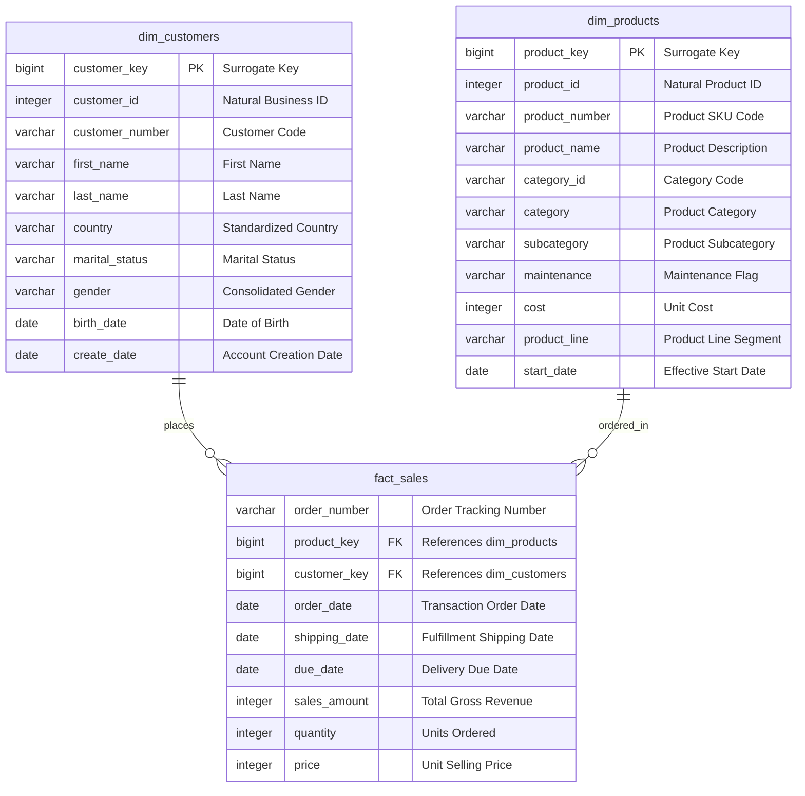

# 📖 Data Catalog & Data Dictionary (Gold Presentation Layer)

- **Warehouse Layer**: Gold (Star Schema / Presentation)
- **Database Engine**: PostgreSQL
- **Schema**: `gold`
- **Architectural Style**: Kimball Dimensional Modeling (Conformed Dimensions & Central Fact)

---

## 1. Architectural Overview & Entity-Relationship Model

The Gold layer presents clean, denormalized, business-ready models optimized for reporting, business intelligence (BI) dashboards, and executive analytics. It decouples analysts from operational source schemas through conformed dimensions and surrogate keys.

---

## 2. Table & View Dictionary

### 2.1 View: `gold.dim_customers`
- **Object Type**: View
- **Description**: Conformed customer dimension providing complete, consolidated customer profiles, demographics, and geographic locations across CRM and ERP systems.
- **Grain**: One row per unique customer profile.
- **Total Record Count**: **18,484**
- **Upstream Lineage**:
  - `silver.crm_cust_info` (Primary customer master & account profile)
  - `silver.erp_cust_az12` (Customer demographics & birthdate)
  - `silver.erp_loc_a101` (Customer geography & standardized location)

#### Field Dictionary

| Column Name | Data Type | Key Type | Nullable | Description & Business Logic | Sample Values |
| :--- | :--- | :---: | :---: | :--- | :--- |
| **`customer_key`** | `BIGINT` | **PK** | No | Surrogate primary key generated via `ROW_NUMBER() OVER (ORDER BY ci.cst_id)` to decouple analytics from operational source keys. | `1`, `2`, `10769` |
| **`customer_id`** | `INTEGER` | Natural | No | Operational customer identifier assigned by the CRM system (`cst_id`). | `11000`, `11001` |
| **`customer_number`** | `VARCHAR(50)` | Business | No | Alphanumeric business customer tracking code (`cst_key`). | `'AW00011000'`, `'AW00011001'` |
| **`first_name`** | `VARCHAR(50)` | Attribute | Yes | Customer's first name, cleaned of unwanted whitespace. | `'Jon'`, `'Eugene'`, `'Christy'` |
| **`last_name`** | `VARCHAR(50)` | Attribute | Yes | Customer's last name, cleaned of unwanted whitespace. | `'Yang'`, `'Huang'`, `'Torres'` |
| **`country`** | `VARCHAR(50)` | Attribute | Yes | Standardized geographic country of residence derived from ERP location records. | `'Australia'`, `'United States'`, `'Germany'` |
| **`marital_status`** | `VARCHAR(50)` | Attribute | Yes | Standardized marital status code (`'Married'`, `'Single'`, `'n/a'`). | `'Married'`, `'Single'` |
| **`gender`** | `VARCHAR(50)` | Attribute | Yes | Consolidated gender identity. Prioritizes CRM records; if unrecorded (`'n/a'`), falls back to ERP demographics. | `'Male'`, `'Female'`, `'n/a'` |
| **`birth_date`** | `DATE` | Attribute | Yes | Validated customer birthdate from ERP demographics. Impossible future dates are nulled out. | `'1971-10-06'`, `'1976-05-10'` |
| **`create_date`** | `DATE` | Attribute | Yes | Date on which the customer account was established in the CRM system. | `'2025-10-06'` |

---

### 2.2 View: `gold.dim_products`
- **Object Type**: View
- **Description**: Conformed product dimension representing the active, current product catalog with integrated category hierarchies and cost specifications.
- **Grain**: One row per current/active product.
- **Total Record Count**: **295**
- **Upstream Lineage**:
  - `silver.crm_prd_info` (Product master records, filtered for active products where `prd_end_dt IS NULL`)
  - `silver.erp_px_cat_g1v2` (Product category and subcategory taxonomy)

#### Field Dictionary

| Column Name | Data Type | Key Type | Nullable | Description & Business Logic | Sample Values |
| :--- | :--- | :---: | :---: | :--- | :--- |
| **`product_key`** | `BIGINT` | **PK** | No | Surrogate primary key generated via `ROW_NUMBER() OVER (ORDER BY pn.prd_start_dt, pn.prd_key)`. | `1`, `9`, `20` |
| **`product_id`** | `INTEGER` | Natural | No | Operational product identifier from CRM catalog (`prd_id`). | `210`, `348`, `500` |
| **`product_number`** | `VARCHAR(50)` | Business | No | Alphanumeric product SKU code (`prd_key`). Joins to sales transaction line items. | `'FR-R92B-58'`, `'BK-M82B-38'` |
| **`product_name`** | `VARCHAR(50)` | Attribute | No | Cleaned, human-readable product title (`prd_nm`). | `'HL Road Frame - Black- 58'`, `'Mountain-100 Black- 38'` |
| **`category_id`** | `VARCHAR(50)` | FK | No | Extracted 5-character category code derived from product SKU prefix (`cat_id`). | `'CO_RF'`, `'BI_MB'`, `'AC_HE'` |
| **`category`** | `VARCHAR(50)` | Attribute | Yes | High-level product category classification mapped from ERP taxonomy. | `'Components'`, `'Bikes'`, `'Accessories'` |
| **`subcategory`** | `VARCHAR(50)` | Attribute | Yes | Detailed product subcategory classification mapped from ERP taxonomy. | `'Road Frames'`, `'Mountain Bikes'`, `'Helmets'` |
| **`maintenance`** | `VARCHAR(50)` | Attribute | Yes | Routine service and maintenance requirement indicator (`'Yes'`, `'No'`, `'n/a'`). | `'Yes'`, `'No'` |
| **`cost`** | `INTEGER` | Measure | Yes | Unit production / procurement cost. Negative costs in Bronze normalized to `0`. | `0`, `450`, `1898` |
| **`product_line`** | `VARCHAR(50)` | Attribute | Yes | Product segment market classification (`'Road'`, `'Mountain'`, `'Touring'`, `'Other Sales'`, `'n/a'`). | `'Road'`, `'Mountain'`, `'Touring'` |
| **`start_date`** | `DATE` | Attribute | No | Effective inception date of the current product revision. | `'2003-07-01'`, `'2011-07-01'` |

---

### 2.3 View: `gold.fact_sales`
- **Object Type**: View
- **Description**: Central transactional fact table containing granular order line-item sales metrics with surrogate key foreign references to dimensions.
- **Grain**: One row per sales order line-item.
- **Total Record Count**: **60,398**
- **Upstream Lineage**:
  - `silver.crm_sales_details` (Validated sales transactions, clean dates, non-negative amounts)
  - `gold.dim_products` (Surrogate foreign key linkage on product number)
  - `gold.dim_customers` (Surrogate foreign key linkage on customer ID)

#### Field Dictionary

| Column Name | Data Type | Key Type | Nullable | Description & Business Logic | Formula / Source | Sample Values |
| :--- | :--- | :---: | :---: | :--- | :--- | :--- |
| **`order_number`** | `VARCHAR(50)` | Degenerate | No | Unique operational sales order header identifier. | `sd.sls_ord_num` | `'SO43697'`, `'SO43698'` |
| **`product_key`** | `BIGINT` | **FK** | No | Surrogate foreign key referencing `gold.dim_products.product_key`. | Joins on `sd.sls_prd_key = pr.product_number` | `9`, `20`, `41` |
| **`customer_key`** | `BIGINT` | **FK** | No | Surrogate foreign key referencing `gold.dim_customers.customer_key`. | Joins on `sd.sls_cust_id = cu.customer_id` | `4`, `3502`, `10769` |
| **`order_date`** | `DATE` | Attribute | No | Calendar date when the order transaction was processed and authorized. | `sd.sls_order_dt` | `'2010-12-29'`, `'2014-01-28'` |
| **`shipping_date`** | `DATE` | Attribute | Yes | Calendar date when goods departed the fulfillment center (`order_date <= shipping_date`). | `sd.sls_ship_dt` | `'2011-01-05'`, `'2014-02-04'` |
| **`due_date`** | `DATE` | Attribute | Yes | Promised or scheduled delivery milestone date (`order_date <= due_date`). | `sd.sls_due_dt` | `'2011-01-10'`, `'2014-02-09'` |
| **`sales_amount`** | `INTEGER` | Metric | No | Total gross sales revenue generated by the line-item. Mathematically guaranteed to equal Quantity × Price. | $\text{quantity} \times \text{price}$ | `3578`, `3400`, `699` |
| **`quantity`** | `INTEGER` | Metric | No | Total discrete item count ordered in this transaction line. Strictly positive integer ($\ge 1$). | `sd.sls_quantity` | `1`, `2`, `10` |
| **`price`** | `INTEGER` | Metric | No | Unit selling price agreed at time of order transaction. Derived from Sales / Quantity when missing. | `sd.sls_price` | `699`, `3400`, `3578` |

---

## 3. Core Business Metrics & Analytical Formulas

| Business KPI | Definition & Calculation | Target Usage |
| :--- | :--- | :--- |
| **Total Revenue** | `SUM(fact_sales.sales_amount)` | Executive top-line financial performance across products, dates, and regions. |
| **Total Volume Sold** | `SUM(fact_sales.quantity)` | Inventory turnover, demand forecasting, and operational logistics tracking. |
| **Average Order Value (AOV)** | `SUM(sales_amount) / COUNT(DISTINCT order_number)` | Customer spending behavior and basket size evaluation. |
| **Gross Margin / Profit** | `SUM(fact_sales.sales_amount) - SUM(fact_sales.quantity * dim_products.cost)` | Product profitability analysis across categories and customer segments. |
| **Customer Retention** | `COUNT(DISTINCT fact_sales.customer_key)` | Active purchasing customer counts across calendar periods. |

---

## 4. Referential Integrity & Quality Guarantees

All objects in the Gold presentation layer adhere to strict data engineering standards verified by the automated testing suite:
- **100% Surrogate Key Resolution**: Zero orphaned transaction records in `fact_sales` (100% of the 60,398 rows map directly to valid `product_key` and `customer_key` values).
- **Zero Cartesian Duplication**: Because dimensions represent singular, current entities (SCD Type 1 view), joining `fact_sales` to `dim_products` and `dim_customers` preserves exact transaction counts with zero row inflation.
- **Mathematical Invariance**: 100% of line-item sales satisfy the business identity $\text{sales\_amount} = \text{quantity} \times \text{price}$.
- **Chronological Validity**: Order dates strictly precede shipping and delivery milestones.
