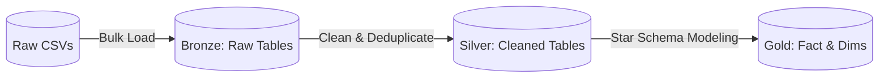

# 📋 Project Plan: SQL Data Warehouse (Sales & Customer Analytics)

- **Author**: Prayash Sapkota
- **Status**: Completed
- **Architecture**: Medallion (Bronze → Silver → Gold)
- **Tech Stack**: SQL (PostgreSQL), Git, GitHub

---

## 1. Project Overview & Scope

### 1.1 Objective
To build an end-to-end modern Data Warehouse that integrates disparate operational data from customer relationship management (CRM) and enterprise resource planning (ERP) systems into a centralized Star Schema optimized for sales reporting and business intelligence.

### 1.2 Boundaries
- **In-Scope**:
  - Ingestion of raw operational source extracts into Bronze staging tables.
  - Data cleansing, standardization, deduplication, and referential validation in the Silver layer.
  - Star Schema dimensional modeling in the Gold layer (Facts & Dimensions).
  - Automated data quality testing, procedure-based pipeline orchestration, and technical documentation.
- **Out-of-Scope**:
  - Real-time streaming ingestion (batch ELT/ETL processing only).
  - End-user visualization dashboard implementation (focused on warehouse data tier).

---

## 2. Requirement Analysis

### 2.1 Key Business Questions & Analytical Goals
1. **Sales Performance**: Total sales revenue, transaction volume, and product profitability across geographic locations and time periods to identify top and bottom performers.
2. **Customer Segmentation**: Sales contribution and purchasing behavior broken down by customer demographic segments (age cohorts, gender, marital status) across regions.
3. **Product Hierarchy Analytics**: Revenue and volume distribution across product categories and subcategories over time.

### 2.2 Source Data Inventory
| Source System | File Name | Grain (What 1 row represents) | Format | Estimated Volume |
| :--- | :--- | :--- | :---: | ---: |
| **CRM** | `cust_info.csv` | 1 customer profile record | CSV | ~10,000–20,000 |
| **CRM** | `prd_info.csv` | 1 product catalog entry | CSV | ~500 |
| **CRM** | `sales_details.csv` | 1 order line-item transaction | CSV | ~60,000 |
| **ERP** | `loc_a101.csv` | 1 customer geographic location | CSV | ~10,000–20,000 |
| **ERP** | `cust_az12.csv` | 1 customer demographic profile | CSV | ~10,000–20,000 |
| **ERP** | `px_cat_g1v2.csv` | 1 product category / subcategory definition | CSV | ~50 |

### 2.3 Data Quality Challenges & Profiling Strategy
Operational extracts from legacy systems inherently contain anomalies that must be systematically remediated in the Silver layer:
- **Identifier Discrepancies**: Inconsistent formatting, system-specific prefixes, and delimiters that obstruct entity resolution across systems.
- **Duplicate Records**: Redundant entries sharing business keys due to asynchronous source extracts or re-transmissions.
- **Categorical Drift**: Unstandardized codes, abbreviations, case variations, and unwanted whitespace in descriptive fields.
- **Temporal & Boundary Anomalies**: Out-of-range dates, chronological inversions (e.g., shipping date preceding order date), and impossible birthdates.
- **Derived Metric Inconsistencies**: Financial and quantity values requiring mathematical reconciliation and non-negative constraints.

### 2.4 Transformation & Standardization Standards
- **Key Harmonization**: Normalize identifier formats across source systems to enable cross-system joins (strip extraneous prefixes, delimiters, and whitespace).
- **Domain Standardization**: Map divergent operational codes (e.g., gender, marital status, country designations) into unified canonical reference values, establishing standard fallback handling (`'n/a'`) for missing or unmapped values.
- **Temporal & Type Casting**: Convert raw integer/text representations of dates and numeric fields into native SQL `DATE` and numeric types with strict boundary validation.
- **Hierarchical Decomposition**: Parse composite operational identifiers into structured dimensions (e.g., decomposing compound product identifiers into distinct category and product components).
- **Mathematical Integrity**: Enforce consistency on financial and operational metrics (e.g., ensuring sales revenue equals quantity multiplied by unit price).

### 2.5 Naming Conventions
- **Casing**: All table and column names strictly use lowercase `snake_case`.
- **Keys**: 
  - Natural / Source IDs use suffix `_id` (e.g., `customer_id`).
  - Warehouse surrogate keys use suffix `_key` (e.g., `customer_key`).
- **Layer Standards**:
  - `bronze`: Staging tables mirroring source schema names.
  - `silver`: Cleansed tables with source prefix retained for lineage traceability.
  - `gold`: Star schema artifacts prefixed with `dim_` (Dimensions) or `fact_` (Facts).

---

## 3. Architecture & Data Modeling

### 3.1 Pipeline Flow

### 3.2 Target Star Schema (Gold Layer)
The presentation layer implements a Kimball Star Schema architecture:
- **Fact Tables**: Granular transactional event records containing surrogate foreign keys to associated dimensions, along with quantitative additive metrics (quantities, pricing, financial totals).
- **Dimension Tables**: Conformed, context-rich master entity descriptors (customer demographics and geography, product catalog hierarchies, and enterprise calendar dimensions) providing filtering and grouping capabilities for analytical reporting.

---

## 4. Data Quality & Testing Strategy

A comprehensive quality assurance framework is implemented across the pipeline. All quality checks are executed as assertion queries where any returned record represents a defect (target expectation: **0 rows**).

### 4.1 Testing Dimensions & Framework

| Testing Dimension | Objective | Implementation Scope (Silver & Gold Layers) | Acceptance Target |
| :--- | :--- | :--- | :---: |
| **Uniqueness & Grain** | Verify primary keys, surrogate keys, and composite grains uniquely identify records with zero duplicate entries. | Partitioned deduplication on IDs in Silver; unique surrogate keys (`customer_key`, `product_key`) and composite grains in Gold. | 0 duplicates |
| **Completeness & Nullability** | Ensure mandatory business keys, foreign keys, and critical attributes contain no missing or empty values. | Null and blank string checks in Silver; zero nulls on surrogate foreign keys in `gold.fact_sales`. | 0 null/blank keys |
| **Referential Integrity** | Validate entity resolution and foreign key linkages between operational systems (CRM & ERP) and star schema tables. | Cross-source reconciliation in Silver; 100% key match between `fact_sales` and dimension views (`dim_customers`, `dim_products`). | 100% key match (0 orphans) |
| **Domain Validity & Standardization** | Enforce unified taxonomies across demographic, geographic, and status attributes. | Standardization of gender codes, marital statuses, country naming conventions, and maintenance indicators across Silver and Gold. | 0 unmapped values |
| **Sanity & Business Math** | Guarantee mathematical consistency and positive numeric ranges for financial calculations. | Validation that transaction sales totals equal quantity multiplied by unit price (`Sales = Quantity * Price`); non-negative cost and price constraints. | 0 math violations |
| **Chronological Consistency** | Verify temporal integrity across business event lifecycles. | Chronological validation ensuring order dates precede or equal ship and due dates; plausible birthdate ranges. | 0 chronological errors |
| **Pipeline Idempotency** | Guarantee automated reload pipelines execute deterministically without row inflation. | Transaction-safe truncation and execution logging in stored procedures (`load_bronze`, `load_silver`); real-time view reflection in Gold. | Deterministic row counts |

### 4.2 Silver Layer Validation Results
All 6 Silver tables have undergone automated testing via `tests/quality_checks_silver.sql` and achieved full compliance:
- **`silver.crm_cust_info`**: 18,484 rows validated; 10 duplicate customer records resolved; clean whitespace and normalized attributes.
- **`silver.crm_prd_info`**: 397 rows validated; 0 null/negative costs; category identifiers extracted; SCD Type-2 dates synchronized.
- **`silver.crm_sales_details`**: 60,398 rows validated; 100% mathematical consistency on sales totals; 0 chronological date inversions.
- **`silver.erp_cust_az12`**: 18,484 rows validated; source identifier prefixes stripped; future/corrupt birthdates nulled; standardized gender.
- **`silver.erp_loc_a101`**: 18,484 rows validated; source formatting resolved; country names standardized with 100% CRM key alignment.
- **`silver.erp_px_cat_g1v2`**: 37 rows validated; category and subcategory hierarchies validated; maintenance flags normalized.

### 4.3 Gold Layer Validation Results
All 3 Gold presentation models have undergone automated validation via `tests/quality_checks_gold.sql` and confirmed 100% Star Schema integrity:
- **`gold.dim_customers`**: 
  - Verified 0 duplicate keys on multi-table join (`cst_id` aggregation returned 0 rows with count > 1).
  - Resolved cross-system gender inconsistencies between CRM and ERP, successfully mapping over 4,500 unknown customer genders down to just 15 across the entire warehouse.
  - Confirmed 18,484 clean records with standardized domain values (`'Male'`, `'Female'`, `'n/a'`).
- **`gold.dim_products`**: 
  - Verified 0 duplicate keys on catalog and category join (`prd_key` aggregation returned 0 rows with count > 1).
  - Verified SCD Type 1 active catalog filter (`WHERE prd_end_dt IS NULL`), yielding exactly 295 unique, active products.
  - Confirmed complete integration with category and subcategory hierarchies with zero Cartesian row inflation.
- **`gold.fact_sales`**: 
  - **100% Referential Integrity**: Verified zero orphaned sales transactions (0 rows with null `customer_key` or `product_key` when left-joined to dimensions).
  - Confirmed all 60,398 line items resolve to valid surrogate keys.
  - Verified mathematical invariance on all records (`sales_amount = quantity * price`).

---

## 5. Risks & Mitigations
| Risk | Impact | Mitigation Strategy |
| :--- | :--- | :--- |
| Schema changes or corrupt formats in raw sources | High | Ingest raw files into Bronze using relaxed data types to prevent pipeline failure, enforcing validation in Silver. |
| Duplicate rows from pipeline re-runs | High | Use idempotent stored procedures with atomic truncation and transaction boundaries. |
| Referential mismatch between operational systems | High | Establish standardized entity resolution logic in Silver; map unmatched keys to unknown dimension members in Gold. |

---

## 6. Execution Roadmap & Milestones

### Phase 1: Project Planning & Architecture
- [x] Initialize Git repository and GitHub remote.
- [x] Create project directory structure (`datasets/`, `sql/`, `tests/`, `docs/`).
- [x] Inspect raw CRM & ERP datasets (identify grain, keys, and volumes).
- [x] Formulate core business questions & analytical KPIs.
- [x] Define naming conventions and transformation standards.
- [x] Document the master project plan (`docs/project_plan.md`).
- [x] Design high-level Medallion Architecture diagram in Draw.io (`docs/diagrams/High-level-Medallion-Architecture.jpg`).

### Phase 2: Environment & Database Setup
- [x] Install / Connect to PostgreSQL database engine.
- [x] Write script to initialize database schemas (`bronze`, `silver`, `gold`).
- [x] Configure database users, permissions, and DBeaver connections.

### Phase 3: Bronze Layer (Raw Ingestion)
- [x] Write DDL scripts for raw staging tables (`sql/bronze/ddl_bronze.sql`).
- [x] Write bulk-load stored procedure (`sql/bronze/proc_load_bronze.sql`).
- [x] Verify raw row counts match CSV source files.
- [x] Design detailed Data Flow diagram in Draw.io (`docs/diagrams/Data-Flow.drawio.png`).

### Phase 4: Silver Layer (Transformation & Cleansing)
- [x] Design Data Integration Diagram in Draw.io (`docs/diagrams/Data-Integration-Diagram.jpg`).
- [x] Profile Bronze tables and establish data cleansing rules.
- [x] Write DDL scripts for silver tables (`sql/silver/ddl_silver.sql`).
- [x] Implement transformation, standardization, and deduplication logic.
- [x] Write stored procedure to populate silver layer (`sql/silver/proc_load_silver.sql`).
- [x] Create automated data quality validation suite (`tests/quality_checks_silver.sql`).

### Phase 5: Gold Layer (Dimensional Modeling & Analytics)
- [x] Design Star Schema Data Model diagram in Draw.io (`docs/diagrams/Data-Model.drawio.png`).
- [x] Design dimensional Star Schema model following Kimball methodology (1 Fact, 2 Dimensions).
- [x] Generate surrogate primary keys (`customer_key`, `product_key`) using `ROW_NUMBER()`.
- [x] Build Customer Dimension view (`gold.dim_customers`) integrating profiles, demographics, and geography.
- [x] Build Product Dimension view (`gold.dim_products`) with category hierarchy and active catalog filter (`prd_end_dt IS NULL`).
- [x] Build Central Fact Sales view (`gold.fact_sales`) referencing surrogate keys (`customer_key`, `product_key`) with order metrics.
- [x] Author technical documentation and catalog (`docs/naming_convention.md`, `docs/data_catalog.md`).
- [x] Create automated data quality validation suite (`tests/quality_checks_gold.sql`).

### Phase 6: Testing & Acceptance Criteria
- [x] Uniqueness Test (verified 0 duplicate keys across all dimensions and composite fact grain).
- [x] Completeness Test (verified 0 null/blank keys across all mandatory join identifiers).
- [x] Referential Integrity Test (100% match rate between `fact_sales` and dimension surrogate keys).
- [x] Domain Validity Test (standardized categories, gender, country names, and maintenance flags).
- [x] Sanity & Business Math Test (100% mathematical consistency on sales totals: Sales = Quantity × Price).
- [x] Chronological Consistency Test (order date precedes shipping and delivery milestones; valid birthdates).
- [x] Pipeline Idempotency Test (verified repeatable procedure executions with deterministic row counts).

### Phase 7: Business Intelligence & Analytical Queries
- [x] Task 7.1: Executive Sales Overview & KPIs (Total revenue, units sold, distinct orders, AOV, ASP).
- [x] Task 7.2: Product Performance & Ranking (Top 10 and Bottom 10 products by revenue, category breakdown).
- [x] Task 7.3: Customer Demographic Segmentation (Revenue and customer distribution by gender and age cohort).
- [x] Task 7.4: Geographic Sales Analysis (Revenue, customer counts, and average spend per customer by country).
- [x] Task 7.5: Product Hierarchy Contribution (Category and subcategory revenue breakdown with % share of category).
- [x] Task 7.6: Time-Series & Month-over-Month (MoM) Growth (Monthly sales trends and MoM growth rate using window functions).

