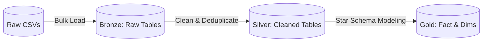

# 📋 Project Plan: SQL Data Warehouse (Sales & Customer Analytics)

- **Author**: Prayash Sapkota
- **Status**: In Progress
- **Architecture**: Medallion (Bronze → Silver → Gold)
- **Tech Stack**: SQL (PostgreSQL), Git, GitHub

---

## 1. Project Overview & Scope

### 1.1 Objective
To build an end-to-end modern Data Warehouse that integrates disparate data from CRM and ERP systems into a centralized Star Schema for sales reporting and business intelligence.

### 1.2 Boundaries
- **In-Scope**:
  - Ingestion of raw ERP and CRM CSV files into Bronze staging tables.
  - Data cleansing, standardization, and deduplication in Silver layer.
  - Star Schema dimensional modeling in Gold layer (Facts & Dimensions).
  - Data quality testing and documentation.
- **Out-of-Scope**:
  - Real-time streaming (batch processing only).
  - Building external frontend web applications.

---

## 2. Requirement Analysis

### 2.1 Key Business Questions & KPIs
1. What is the total sales revenue, order volume, and profit/loss for a given product across specific locations and time periods, and which products are the top/bottom performers?
2. What percentage of total sales is generated by different customer demographics (age brackets and gender) for specific products, dates, and locations?
3. What is the sales revenue breakdown by product category and subcategory across different countries and date ranges?

### 2.2 Source Data Inventory
| Source System | File Name | Grain (What 1 row means) | Format | Estimated Rows |
| :--- | :--- | :--- | :---: | ---: |
| **CRM** | `cust_info.csv` | 1 customer profile | CSV | ~10,000 |
| **CRM** | `prd_info.csv` | 1 product catalog item | CSV | ~500 |
| **CRM** | `sales_details.csv` | 1 order line-item | CSV | ~60,000 |
| **ERP** | `loc_a101.csv` | 1 customer geographic location | CSV | ~10,000 |
| **ERP** | `cust_az12.csv` | 1 customer demographic record | CSV | ~10,000 |
| **ERP** | `px_cat_g1v2.csv` | 1 product category / subcategory | CSV | ~50 |

### 2.3 Data Profiling & Issues Found (The "Dirty Data" Audit)
*(To be populated during the Silver layer data inspection)*

### 2.4 Transformation & Business Rules
- **Gender Standardization**: Standardize all CRM and ERP gender values to `'Male'`, `'Female'`, or `'n/a'`.
- **Key Cleansing**: Remove prefixes (`'NAS'`) and hyphens (`'-'`) from ERP Customer IDs to match CRM keys.
- **Product Key Decomposition**: Split `prd_key` into `category_id` and `product_number`.
- **Date Conversion**: Cast integer dates (`20101229`) into standard SQL `DATE` format.

### 2.5 Naming Conventions
- **Casing**: All table and column names strictly use `snake_case`.
- **Keys**: 
  - Source IDs use suffix `_id` (e.g., `customer_id`).
  - Warehouse surrogate keys use suffix `_key` (e.g., `customer_key`).
- **Gold Tables**:
  - Dimensions prefixed with `dim_` (e.g., `dim_customers`).
  - Fact tables prefixed with `fact_` (e.g., `fact_sales`).

---

## 3. Architecture & Data Modeling

### 3.1 Pipeline Flow

### 3.2 Target Star Schema (Gold Layer)
- **Fact Table**:
  - `fact_sales`: Order Number, Line Item, Date Key, Customer Key, Product Key, Quantity, Unit Price, Total Amount.
- **Dimension Tables**:
  - `dim_customers`: Customer Key (Surrogate), Customer ID, Full Name, Gender, Country, City.
  - `dim_products`: Product Key (Surrogate), Product ID, Category, Subcategory, Unit Cost.
  - `dim_date`: Date Key, Full Date, Year, Quarter, Month, Month Name, Day of Week.

---

## 4. Data Quality & Testing Strategy
*(To be populated as tests are written in the testing scripts)*

---

## 5. Risks & Mitigations
| Risk | Impact | Mitigation Strategy |
| :--- | :--- | :--- |
| Schema changes in source CSVs | High | Bronze tables use loose `VARCHAR` types to prevent ingestion crashes. |
| Pipeline executed twice causes duplicate rows | High | Use `TRUNCATE TABLE` or `MERGE` statements inside stored procedures to ensure idempotency. |

---

## 6. Execution Roadmap & Checklist

### Phase 1: Project Planning & Architecture
- [x] Initialize Git repository and GitHub remote.
- [x] Create project directory structure (`datasets/`, `sql/`, `tests/`, `docs/`).
- [x] Inspect raw CRM & ERP datasets (identify grain, keys, and volumes).
- [x] Formulate core business questions & KPIs.
- [x] Define naming conventions and transformation rules.
- [x] Document the master project plan (`docs/project_plan.md`).
- [x] Design high-level Medallion Architecture diagram in Draw.io.
- [x] Save architecture & schema diagrams into `docs/diagrams/`.

### Phase 2: Environment & Database Setup
- [x] Install / Connect to SQL Database (PostgreSQL).
- [x] Write script to initialize the database and schemas (`bronze`, `silver`, `gold`).
- [x] Configure database users, permissions, and connections.

### Phase 3: Bronze Layer (Raw Ingestion)
- [x] Write DDL scripts for raw staging tables (`sql/02_bronze/ddl_bronze.sql`).
- [x] Write bulk-load stored procedure (`sql/02_bronze/proc_load_bronze.sql`).
- [x] Verify raw row counts match CSV files.
- [x] Design detailed Data Flow diagram of bronze layer in Draw.io.

### Phase 4: Silver Layer (Transformation & Cleansing)
- [ ] Profile Bronze tables and log dirty data issues in section 2.3.
- [ ] Write DDL scripts for silver tables (`sql/03_silver/ddl_silver.sql`).
- [ ] Implement cleaning logic: cast data types, trim whitespace, normalize gender codes.
- [ ] Resolve ERP ID prefixes (`NAS`, `-`) and split product keys.
- [ ] Write stored procedure to populate silver layer (`sql/03_silver/proc_load_silver.sql`).

### Phase 5: Gold Layer (Star Schema & Views)
- [ ] Generate surrogate keys (`customer_key`, `product_key`).
- [ ] Build Dimension tables (`dim_customers`, `dim_products`, `dim_date`).
- [ ] Build Fact table (`fact_sales`) with foreign key references.
- [ ] Create analytical reporting views.

### Phase 6: Testing & Acceptance Criteria
- [ ] **Uniqueness Test**
- [ ] **Referential Integrity Test**
- [ ] **Completeness (Nullability) Test**
- [ ] **Validity (Domain Constraints) Test**
- [ ] **Sanity & Boundary Test**
- [ ] **Chronological Consistency Test**
- [ ] **Reconciliation Test**
- [ ] **Business Verification**
